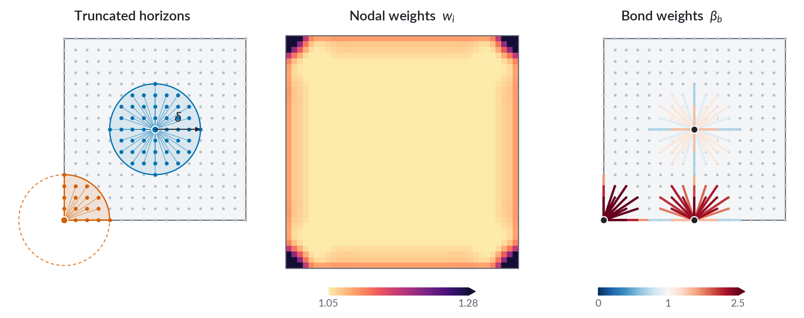
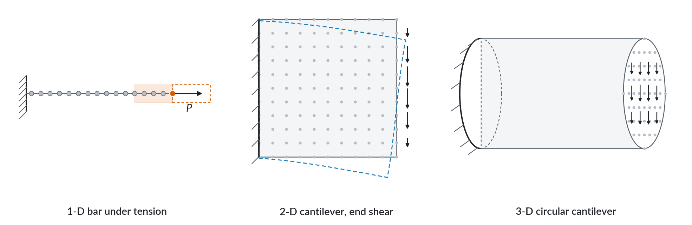
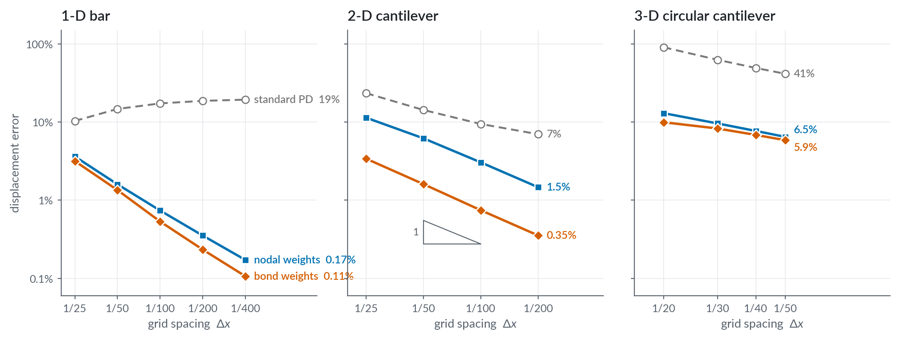
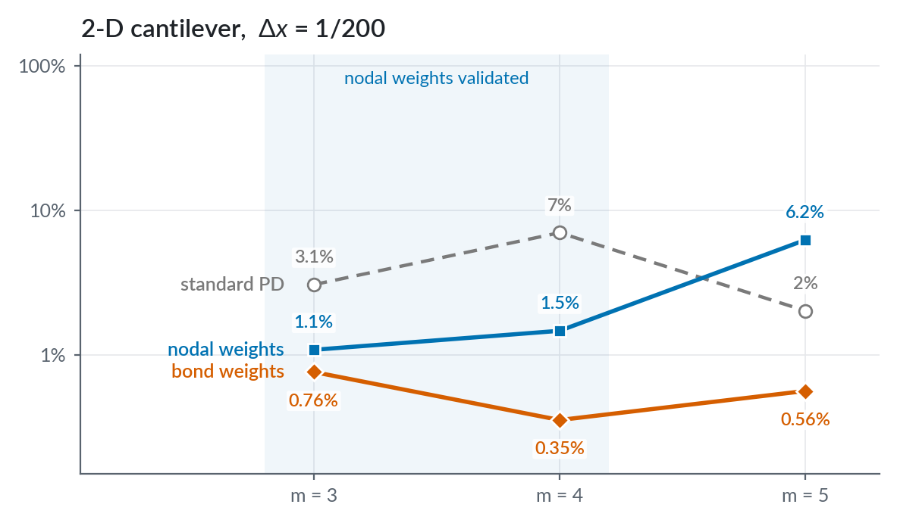
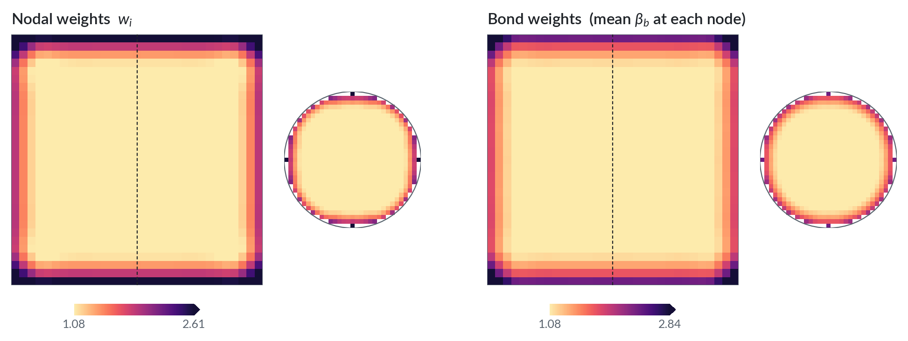

<p align="center">
  <picture>
    <source media="(prefers-color-scheme: dark)" srcset="https://raw.githubusercontent.com/Hereon-InstituteMS/perifit/v3.0.0/docs/images/hero_dark.png">
    
  </picture>
</p>

<h1 align="center">perifit</h1>

<p align="center">
  <b>Surface corrections for peridynamics — one weight per node, or one weight per bond.</b><br>
  1-D · 2-D · 3-D &nbsp;|&nbsp; any solver &nbsp;|&nbsp; purely geometric
</p>

<p align="center">
  <a href="https://github.com/Hereon-InstituteMS/perifit/actions"></a>
  <a href="https://pypi.org/project/perifit/"></a>
  <a href="https://pypi.org/project/perifit/"></a>
  <a href="https://github.com/Hereon-InstituteMS/perifit/blob/v3.0.0/LICENSE"></a>
  <a href="https://doi.org/10.1002/nme.70385"></a>
</p>

---

## What it does

In peridynamics every node interacts with all neighbours inside its horizon δ.
Near free surfaces, cracks and voids part of that horizon is missing, so the
material there is **too soft** — and the error does not go away when the grid
is refined. perifit computes, once and from the geometry alone, a correction
that makes every truncated horizon behave like a full one:

| | **nodal weights** | **bond weights** |
|---|---|---|
| what you get | one weight `w_i` per node | one weight `β_b` per bond |
| how a bond is scaled | `(w_i + w_j) / 2` | `β_b` |
| fitted to | derivative and energy operators of a full horizon | the energy moments of a full horizon, at every node |

Both need only the node positions, the nodal volumes and the horizon — no
material constants.

## Install

```bash
pip install perifit
```

Optional readers/writers: `pip install "perifit[all]"` (VTU, Exodus, Gmsh/Abaqus input; PeriLab HDF5 output).

## Quick start

```python
import numpy as np
import perifit

dx = 1 / 40                                            # a unit square, horizon δ = 4 dx
s = np.arange(0, 1 + dx / 2, dx)
coords = np.stack(np.meshgrid(s, s, indexing="ij"), -1).reshape(-1, 2)
volumes = np.full(len(coords), dx**2)

corr = perifit.surface_correction(coords, volumes, 4 * dx, method="bond")   # or "nodal"
# corr.bonds[b] = (i, j);  multiply the stiffness of bond b by corr.factor[b]
```

The two methods are also available directly:

```python
w = perifit.nodal_weights(coords, volumes, horizon)            # (N,)
bonds, beta = perifit.bond_weights(coords, volumes, horizon)   # (Nb, 2), (Nb,)
```

From the command line:

```bash
perifit --mesh part.csv --method nodal --output csv,vtk,peridigm
perifit --mesh part.csv --method bond  --output csv,npz
```

## Which method should I use?

| | nodal weights | bond weights |
|---|---|---|
| storage | N numbers | one per bond (≈ 25 N in 2-D, ≈ 130 N in 3-D at m = 4) |
| accuracy | good | best, in every benchmark |
| models | bond-based 1-D/2-D/3-D, state-based (LPS) 3-D | bond-based 1-D/2-D/3-D |
| fracture | computed once for the intact geometry | broken bond = `β_b = 0`; the other weights stay valid |
| horizon ratio m = δ/Δx | 2-D validated for m = 3–4 | robust for m = 3–5 |
| solver input | per-node field (Peridigm, PeriLab, VTK) | per-bond list (CSV, NPZ) |

**Use bond weights when your solver can take a value per bond; use nodal
weights for per-node solvers or when memory is tight.**

## Results

Three static problems with exact solutions, standard bond-based PD with
horizon δ = 4 Δx and no partial-volume correction:

<p align="center">
  <picture>
    <source media="(prefers-color-scheme: dark)" srcset="https://raw.githubusercontent.com/Hereon-InstituteMS/perifit/v3.0.0/docs/images/setups_dark.png">
    
  </picture>
</p>

<p align="center">
  <picture>
    <source media="(prefers-color-scheme: dark)" srcset="https://raw.githubusercontent.com/Hereon-InstituteMS/perifit/v3.0.0/docs/images/convergence_dark.png">
    
  </picture>
</p>

| relative displacement error, finest grid | standard PD | nodal weights | bond weights |
|---|---|---|---|
| 1-D bar (Δx = 1/400) | 19 % — *grows* with refinement | 0.17 % | **0.11 %** |
| 2-D cantilever (Δx = 1/200) | 7.0 % | 1.5 % | **0.35 %** |
| 3-D circular cantilever (Δx = 1/50) | 41 % | 6.5 % | **5.9 %** |

Standard PD stays inaccurate because of the boundary layer; both corrections
restore convergence. Bond weights also remove the anisotropy of the square
grid, which keeps them accurate for every horizon ratio:

<p align="center">
  <picture>
    <source media="(prefers-color-scheme: dark)" srcset="https://raw.githubusercontent.com/Hereon-InstituteMS/perifit/v3.0.0/docs/images/horizon_ratio_dark.png">
    
  </picture>
</p>

In 3-D the correction lives in a thin layer along the whole surface of the bar:

<p align="center">
  <picture>
    <source media="(prefers-color-scheme: dark)" srcset="https://raw.githubusercontent.com/Hereon-InstituteMS/perifit/v3.0.0/docs/images/weights_3d_dark.png">
    
  </picture>
</p>

Reproduce everything with `python examples/benchmarks.py` and `python docs/make_figures.py`.

## Using the corrections in your solver

A bond-based solver multiplies the micromodulus of bond `(i, j)`:

```
c_ij = c * (w_i + w_j) / 2      # nodal weights
c_ij = c * beta_ij              # bond weights
```

State-based (LPS) solvers apply `(w_i + w_j)/2` to every term that involves
deformation; the weighted volume keeps its analytical full-horizon value.
Do **not** combine the weights with a partial-volume (β) factor — they already
correct the horizon quadrature.

The corrections belong to the reference configuration and are kept fixed during
a run: crack faces that open later are not corrected, which is consistent with
calibrating the critical stretch with the same weights. For several bodies or
initial pre-cracks, pass precomputed `families` that exclude bonds across them.
After removing nodes with `clean_mesh`, pass `horizon=` so that the weights are
recomputed for the cleaned mesh (the neighbourhoods have changed).

## Command line

| | `--method nodal` | `--method bond` |
|---|---|---|
| models | `--model osb` (default) or `bb` | `bb` |
| outputs | `csv`, `dat`, `vtk`, `peridigm`, `perilab` | `csv` (`i,j,beta`), `npz` |
| extras | `--diagnose`, `--clean` | — |

The horizon is `--horizon`, or `--m-ratio` × the median nearest-neighbour
spacing. Planar meshes stored as `(x, y, 0)` need `--dim 2`. Try
`perifit --demo --method bond`.

## Upgrading from v2

- Choose the method explicitly: `surface_correction(..., method=...)`, `nodal_weights`, `bond_weights`.
  `compute_weights`, `compute_weights_2d` and `compute_weights_1d` still work but are deprecated.
- 1-D and 2-D nodal weights use a revised, validated calibration, and 3-D weights no
  longer depend on round-off or on the length unit; values differ from v2 —
  see [CHANGELOG.md](https://github.com/Hereon-InstituteMS/perifit/blob/v3.0.0/CHANGELOG.md). To reproduce the figures of the IJNME paper
  exactly, install `perifit==2.0.1`.
- The CLI requires `--method`.

## Citing

If you use perifit, please cite

```bibtex
@article{shojaei2026surface,
  title   = {Surface and Boundary Corrections in Peridynamics Using Optimized Nodal Influence Weights},
  author  = {Shojaei, Arman and Ongaro, Greta and Hermann, Alexander and Silling, Stewart A.
             and Trovalusci, Patrizia and Cyron, Christian J.},
  journal = {International Journal for Numerical Methods in Engineering},
  year    = {2026},
  doi     = {10.1002/nme.70385}
}
```

## License

MIT — Arman Shojaei & Alexander Hermann, Institute of Material Systems
Modeling, Helmholtz-Zentrum Hereon, Germany.
